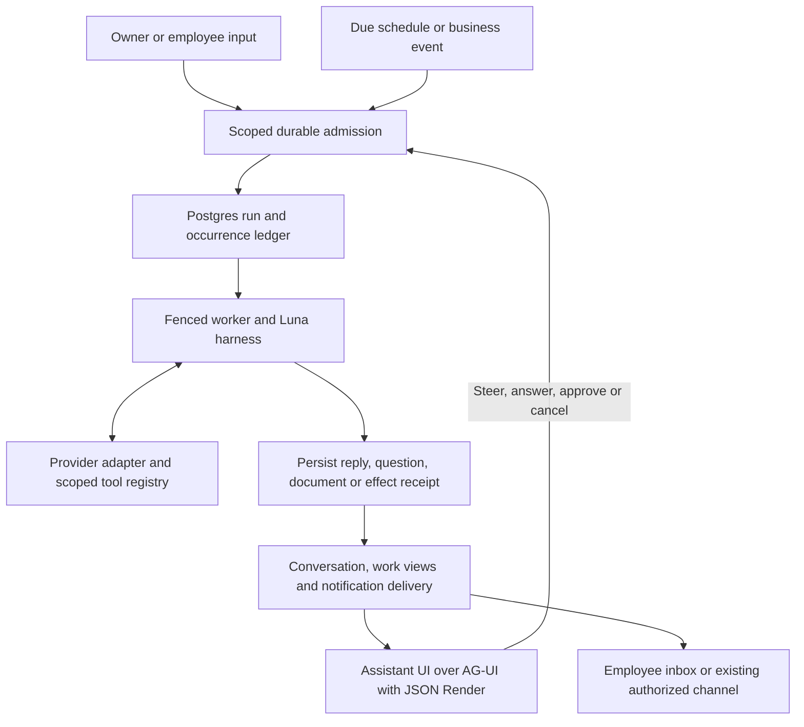

# Luna rebuild implementation handoff

Start with the [fresh-session handoff](#fresh-session-handoff). The product is a proactive operator for owner-led retail businesses. Owners delegate outcomes through conversation. Luna can independently observe, investigate, schedule, act within an approved mandate, reach staff through their own scoped inbox and bring the owner the results or a decision. Launch as one Luna across surfaces. Preserve business data, conversations, approvals, schedules and saved files. The [reference comparison and acceptance ledger](luna-rebuild.md) cover the seven interaction projects, model SDKs and the migration scope.

The architecture was based on main at `28622880e664cba2b9396546e551806eb66f7c80`. At the November 27 safeguard review, PR #593 was a draft at `74a2ccbf3f4df46809ffb076793ccd958e1a8d33`. Both PRs edit `scripts/db/run-all.sh`. The integrator of whichever PR merges second must preserve both sets of DB checks and verify that the combined runner executes them. It owns external ingest, archives, grants and research discovery. Luna uses its merged tenant-scoped interfaces, with no new connection or ingestion stack. The rebuild can implement against current canonical business services and an interface for scoped source access now. Once #593 merges, check its effective grant semantics and reconcile any overlaps with its research tools or migrations. [PR #593](https://github.com/killbill2792/aicafe/pull/593)

## What the execution references establish

| Lifecycle | Source and test evidence | Requirement for Luna |
| --- | --- | --- |
| Admit an interactive request | OpenClaw's agent turn service resolves the expected session, reserves request identity, commits input under the current principal, reserves the session lane and publishes acceptance plus replay. Its session controller owns the mailbox across entry points. Hermes uses an origin descriptor, a logical session and an ordered overflow queue. | Acknowledge only stored input and its logical run. Browser, WhatsApp and staff use a common admission contract. Carry actor, tenant, source, request key and conversation. Repeated admission returns the same run. [OpenClaw turn service](https://github.com/openclaw/openclaw/blob/8d356ea5b2bf0273bca359c468a75c20be363888/src/gateway/agent-turn/agent-turn-service.ts) · [OpenClaw session controller](https://github.com/openclaw/openclaw/blob/8d356ea5b2bf0273bca359c468a75c20be363888/docs/concepts/session-controller.md) · [Hermes gateway lifecycle](https://github.com/NousResearch/hermes-agent/blob/1d15aad1dfa8e9e5fcbd2082cad5666a0907a07d/website/docs/developer-guide/gateway-session-lifecycle.md) |
| Reason and use tools | OpenClaw's model attempt emits distinct lifecycle, text and tool events. A native Responses event can finish a provider response while the host turn continues. Hermes builds context, selects its provider wire format and pairs every tool call with a result, including interrupted calls. Its registry supports progressive search and description of tools before invocation. | Keep application state and provider continuation distinct. Reuse native provider tools, current business tools and dynamically discoverable tool descriptions. Decide completion after tool and output persistence. Return validation and capability failures to the model as tool results. [OpenClaw loop](https://github.com/openclaw/openclaw/blob/8d356ea5b2bf0273bca359c468a75c20be363888/docs/concepts/agent-loop.md) · [Hermes loop](https://github.com/NousResearch/hermes-agent/blob/1d15aad1dfa8e9e5fcbd2082cad5666a0907a07d/agent/conversation_loop.py) · [Hermes tool discovery](https://github.com/NousResearch/hermes-agent/blob/1d15aad1dfa8e9e5fcbd2082cad5666a0907a07d/website/docs/user-guide/features/tool-search.md) |
| Steer, stop, wait and recover | OpenClaw feeds accepted steering to the next legal model boundary and keeps its original order if replay is safe. A yielded parent retains a specific wake obligation across successor admission. Hermes tests request-scoped provider interruption, tool-result closure and durable ownership after worker death. | Accept edits as ordered durable inputs. Record an exact run cancellation and fence the old worker. Resume a question or child result through its saved identity. Release the worker while waiting. A new tab or worker must be able to see what was accepted. [OpenClaw steering](https://github.com/openclaw/openclaw/blob/8d356ea5b2bf0273bca359c468a75c20be363888/docs/concepts/queue-steering.md) · [OpenClaw yield and handoff](https://github.com/openclaw/openclaw/blob/8d356ea5b2bf0273bca359c468a75c20be363888/docs/concepts/subagent-yield-handoff.md) · [Hermes interruption tests](https://github.com/NousResearch/hermes-agent/blob/1d15aad1dfa8e9e5fcbd2082cad5666a0907a07d/tests/agent/test_close_interrupted_tool_sequence.py) |
| Timed and event-triggered work | OpenClaw records schedule ownership apart from a finished attempt and routes a signed event into the existing automation path. Hermes records a provisional missed occurrence before dispatch, tracks the scheduled instant, bounds catch-up and coalesces permitted bursts by entity. Its idle heartbeat can wake an existing conversation and yield no notification when nothing changed. | Use the existing minute worker independent of POS refresh. Durable due identity, schedule revision, UTC instant and IANA zone belong to the occurrence. Keep relative request time and worker time distinct. Store trigger observations, source event IDs, quiet windows and reasons for skipped or coalesced work. Keep one-shot reminders pending through recoverable delay. Let Luna evaluate material changes and suppress routine chatter. An unavailable source stays visible to Luna and in work history. [OpenClaw schedules](https://github.com/openclaw/openclaw/blob/8d356ea5b2bf0273bca359c468a75c20be363888/docs/automation/cron-jobs/schedules.md) · [OpenClaw events](https://github.com/openclaw/openclaw/blob/8d356ea5b2bf0273bca359c468a75c20be363888/docs/automation/mcp-events.md) · [Hermes missed occurrences](https://github.com/NousResearch/hermes-agent/blob/1d15aad1dfa8e9e5fcbd2082cad5666a0907a07d/website/docs/developer-guide/cron-internals.md) · [Hermes heartbeat](https://github.com/NousResearch/hermes-agent/blob/1d15aad1dfa8e9e5fcbd2082cad5666a0907a07d/website/docs/user-guide/features/heartbeat.md) |
| Settle outputs and deliver | OpenClaw's terminal receipt distinguishes a saved reply and provider-confirmed delivery. Hermes cron write-back matches the exact execution in both queue and run record, regardless of which settles first. Hermes interactive recovery can visibly redeliver a possibly sent message. Hermes cron fences an ambiguous send as unknown. | Use an immutable delivery key per result and destination. In-product delivery can commit result and receipt atomically. Externally use the connector's idempotency or reconcile via its receipt. Keep uncertainty visible and avoid automatic duplicate reminders or effects where proof is unavailable. [OpenClaw delivery](https://github.com/openclaw/openclaw/blob/8d356ea5b2bf0273bca359c468a75c20be363888/docs/automation/cron-jobs/delivery.md) · [Hermes delivery write-back](https://github.com/NousResearch/hermes-agent/blob/1d15aad1dfa8e9e5fcbd2082cad5666a0907a07d/cron/delivery_outcome.py) · [Hermes interactive delivery ledger](https://github.com/NousResearch/hermes-agent/blob/1d15aad1dfa8e9e5fcbd2082cad5666a0907a07d/gateway/delivery_ledger.py) |
| Learn and correct | OpenClaw records source lineage for promotion, merges and supersession. Hermes separates transcript search, curated memory and procedural skills. Fork tests exercise memory read/write scope, while staged corrections bind to the exact revision. | Keep scoped business facts, editable owner memory and learned instructions distinct. Store provenance and revision. Resolve active memory on each new run and check access on resume. Skills can be discovered by description and loaded on demand. A learned skill or employee observation cannot grant a tool permission or supersede canonical metrics. [OpenClaw memory provenance](https://github.com/openclaw/openclaw/blob/8d356ea5b2bf0273bca359c468a75c20be363888/docs/concepts/memory-provenance.md) · [Hermes memory](https://github.com/NousResearch/hermes-agent/blob/1d15aad1dfa8e9e5fcbd2082cad5666a0907a07d/website/docs/user-guide/features/memory.md) · [Hermes skills](https://github.com/NousResearch/hermes-agent/blob/1d15aad1dfa8e9e5fcbd2082cad5666a0907a07d/website/docs/user-guide/features/skills.md) |

### Grok Bot decision, November 27, 2026

Keep one Luna per business across owner chat, staff inbox and background work. Give each assignment an accountable actor, an audience and a return conversation. A café owner should be able to close the app during an investigation, come back to the reason it started, see what Luna found and make the one decision that still needs them. xAI describes this experience in terms of a persistent Bot, chat, prompts, tools and artifacts. Its product guides describe what a user can observe. Luna’s storage and authorization choices below follow from our own application contracts. [Grok Bot overview](https://docs.x.ai/grok-bot/overview.md) · [Worked example](https://docs.x.ai/grok-bot/how-grok-bot-works.md) · [Designing Grok Bot](https://x.ai/news/designing-grok-bot)

| Decision | Contract for the replacement harness |
| --- | --- |
| Keep the origin and the return address | On admission bind the business, initiating user or verified trigger, effective principal, thread, permitted recipient, source ID and request time to the run. Give a delegated step a parent run, a scoped input reference and one return destination. A duplicate result wakes the parent once. Recheck membership and source access before copying even a summary into a staff inbox. A follow-up outside the existing mandate is an offer the owner can accept in the originating thread. |
| Put standing work under owner control | A skill describes inputs, source access, procedure, expected result and review points. A routine binds that instruction revision to an owner, trigger, activation boundary, business zone, destination and missing-data policy. Creating or resuming a routine schedules future eligible inputs. Preserve already admitted occurrences and apply the existing bounded recovery policy to missed work. Test runs use a distinct request key and the same budget and effect rules. Pause fences future dispatch, and a later edit leaves prior run history readable. |
| Make initiative legible | Persist the source observation, its time, why it mattered, and the chosen disposition. A material change can start an investigation. Missing access can warrant a reconnect request. An unchanged observation can close quietly. Suppressing an alert for quiet hours or user settings affects notification delivery only. Project the saved status, next decision and result into the same transcript. Let an owner open details from a phone or desktop without exposing private model traces. |
| Keep approvals with the exact operation | Treat attachment text, connector events and tool results as evidence with an origin. Only the applicable owner authorization can approve an effect. Reuse the existing proposal revision, effect hash and receipt. Show the concrete target, account, recipient and artifact revision where applicable. Denial, supersession, revocation or cancellation prevents dispatch. Enforce any deadline defined by the capability. A reconnect or clarification can resume the same assignment after fresh checks. Secrets travel through the existing connection flow. |
| Keep results and learned instructions scoped | Save the artifact and its source references before announcing it. Chat and the file view point to the same document revision. Editing uses the expected predecessor. Preview controls only change the view. A new revision requires fresh approval for an operation bound to the previous content. A staff lesson starts in the contributor’s scope. Promotion to a business-wide instruction requires owner review of its source and exact revision. A correction or withdrawal affects future use and preserves the audit trail. |

Use existing registered café tools and scoped connector accounts. Grok Bot documents personal and team computers, browser sessions shared among a user's bots, custom MCP tools, secret entry, collaborative bots and additional channels. For this rebuild, an unavailable capability produces a scoped blocker and a route back to the assignment. A shared desktop, unrestricted shell/browser, new vault, public page sharing, bot marketplace, new messaging channels and a roster of agents are outside #594. The ledger links each design choice to a source and a scenario that can expose a broken contract. [Research and acceptance ledger](luna-rebuild.md#grok-bot-primary-source-review)

## Selected architecture



- **Harness and state.** Reuse the existing Postgres run claims, worker quota accounting, proposals and effect receipts. Build the Luna step orchestration around authenticated input, provider attempts, tool execution, persisted output and delivery. Inspect the run repository, checkpoint SQL in `supabase/migrations/20261119170001_task6_15c_owner_run_checkpoint.sql`, old worker and chat runner as reference. Put orchestration in the new runtime and reuse independently callable services. Today the legacy owner, commitments, routines and investigations enter distinct execution paths. The first integration must show one newly admitted on-turn request and one off-turn occurrence evaluated by the same replacement harness.
- **Provider and capabilities.** Define a bounded adapter for native stream events, continuation, invocation, usage, typed errors and termination. Start with existing OpenAI Responses transport and approved model configuration. Keep Responses deferred discovery and provider-native tools where appropriate. Vercel AI SDK provider contracts are the interoperability reference for Anthropic and Gemini. OpenAI Agents JS provides comparison points for serialization and resuming a particular tool approval. A provider library can own request or event normalization. Persisted state, usage, permissions and effects remain application contracts. Change the production model only with recorded tool accuracy, cost per completed assignment and time to first useful result on the same authorized corpus.
- **Scheduler.** Target the existing Vercel minute tick in `app/api/cron/supervisor-run-worker/route.ts`. Use its shared queue and tenant fairness when scheduling reminders, investigating a changed observation or running a recurring assignment. Keep `refresh-derived` responsible for preparing relevant data. Share existing commitments, routine definitions and occurrence records while migrating admission. The current business/routine/local-date uniqueness serves one occurrence per day and needs a compatible due-instant identity for higher frequencies and an event identity for event-triggered work. Enforce claim ownership and use measured load and due lag to size batches. Prove delivery when refresh is disabled.
- **Interaction.** Adopt Assistant UI primitives with the official `@assistant-ui/react-ag-ui` runtime and AG-UI events. Use server IDs, persisted snapshots and a reconnect cursor. The worker's verified state owns buttons and status. Disconnecting drops a subscription. Stop calls server cancellation and awaits the result. Preserve original question values including zero and false, exact approval versions, chronological conversation and saved outputs. Use the same APIs for touch and desktop. The new UI is opt-in during migration. CopilotKit's runtime, A2UI, AI Elements and OpenBot supplied alternatives and interoperability evidence, detailed in the [comparison](luna-rebuild.md).
- **Presentation and files.** Use the existing JSON Render catalog and React/PDF packages. Keep the full authored document, plain content and safe presentation data. Render supported nodes and preserve unsupported sections as readable or downloadable data. Send Luna structured diagnostics with the relevant source path and reason so it can repair or choose another representation. Use private attachment storage and stable document/version IDs, immutable revisions and an expected predecessor for edits. Check receipt and authorization before presenting a saved or downloaded document. Prior attachments and reports remain discoverable.
- **Permissions and rollout.** Resolve the acting user and active business from trusted context. Recheck source grants, recipient membership and effect authorization immediately before execution, after resume and on artifact access. Existing proposal and receipt services govern external effects. Pin the engine atomically at admission and keep it immutable across workers. On rollback stop new rebuild admissions, drain or reconcile previously admitted work by its recorded engine and preserve existing IDs. Owner approved local engine pinning, occurrence deduplication and predecessor-versioned documents in this conversation. Production activation, migrations, paid verification and destructive retirement have separate authorization.

## Owner operating contract

**Decision.** Launch one autonomous operator per business. An owner opts the business into Luna, delegates a remit, sets limits and reviews exceptions. Routine administration is optional. With the owner offline, Luna must be able to discover a material change, establish what happened, choose a next action and recipient, coordinate the people doing the physical work, and check the business outcome. The owner can inspect the original work or intervene at any stage.

### What starts work and what can close it

Use the existing Watch assignment for a business whose owner explicitly enables proactive observation. Keep the existing daily review at the configured business-local time (default 09:00), independently of event and follow-up wakes. Show its remit and next check in Work. At onboarding, bind it to the business, verified owner, allowed source classes, audience, notification policy and budget. Wake it on a newly committed eligible observation, a due recheck, an unanswered staff request or the business's next scheduled review. The schedule also lets Luna discover opportunities without an incoming event. Keep a deduplication key and one durable progress cursor per monitored source scope. Use the source’s committed ingestion sequence or an overlap window and stable record identity for late and corrected records. Advance it transactionally with a recorded disposition or durable successor. An outage leaves a retryable gap. Pause, source revocation and opting out stop new admissions for the affected scope.

Use the same model/tool loop for unfamiliar work. Supply a compact list of changes since the last reviewed observation, outstanding obligations, coverage, current grants and tool descriptions. Luna may inspect a source, relate it to a prior episode, seek corroboration, draft work, route a question or record why no intervention is justified. Business identity, row access, tool execution, budget, deadlines and effect authorization are enforced by code. Keywords, customer identities and example café scenarios do not choose an investigation. Financial amounts come from canonical shared calculations.

Each investigation in `supervisor_investigations` links the trigger and source revisions to an episode and its parent run. Persist a concise decision, evidence for and against it, uncertainty, affected business role, recommended action, return conversation, expected outcome and next check. A long-running case must have a live obligation, a documented blocked reason or a verified closure. A read-only Watch can open a linked assignment for an authorized action. The new assignment obtains its own grant and budget. Private staff and payroll data stay outside Watch’s default scope. Today the Watch code relies partly on instructions for those exclusions while exposing a SQL research tool. Give its research principal access only to approved views and columns, enforce live business and audience checks in the database, and verify that alternate query paths yield the same decision. [Current Watch scope](../../lib/ai/supervisor/routines/objective.server.ts) A staff acknowledgement records receipt. A staff report records a claim. Close on the specified outcome evidence, including an authorized human confirmation when only a person can observe the physical result. A missed deadline reopens or escalates the case. Corrections append a superseding decision and preserve the history.

### Who can see, direct and approve work

| Work | Decision |
| --- | --- |
| Independent analysis | Under the business remit Luna may read authorized evidence, use canonical calculations, investigate, draft privately, schedule a recheck and report a finding. An incomplete feed yields a dated partial result or an access request. |
| Employee communication | Use `staff_communication_requests` and `staff_communication_messages`. Resolve the employee assignment, active membership, work purpose, channel binding and permitted fields on the server. Send only when the existing capability has its required approval or a valid mandate for that precise action. Otherwise retain the draft for the owner. Preserve the supported owner-tapped external send flows. |
| Owner oversight | In the existing owner conversation and Work view, project business instructions, original authorized staff messages, investigation evidence, pending decisions, mandates, schedules, receipts and unresolved follow-ups. Link to original records for inspection. Record business purpose and audience on admission and enforce them against live membership on every read, including rows exposed through the Data API. Keep personal employee conversations outside the business history. For mixed-scope work expose a permitted business summary and record the reason detail is restricted. Apply the same checks to search, exports, model context, links and notifications. |
| Consequential effects | Use `supervisor_proposals`, versioned `supervisor_mandates` and `supervisor_effect_attempts`. Compare the active grant or click, action, payload hash, recipient, account and artifact revision immediately before dispatch. Retain the exact supplier-email click, stock instruction exception and per-capability limits. No expansion of existing authority. |
| Intervention | Persist stop, redirect and corrections against the exact run or instruction revision. Fence outstanding workers, recheck live membership and grants, and invalidate stale proposals. Reconcile work already dispatched. Require a separately authorized compensating action if reversal is possible. Keep a receipt for what actually happened. |

### When work runs

**Use the current Vercel deployment and Postgres queue.** The authenticated web request persists the owner input and wakes its specific run immediately. A verified event handler persists its deduplicated source receipt and wakes eligible work after commit. The signed Toast webhook already demonstrates this pattern for collection. Connect Luna to committed authorized observations, using #593’s resource scope, coverage and grant checks as they become available. An ingress acknowledgement proves receipt. Only a worker claim proves execution started. For polling-only sources show observation time, successful collection time, window, expected cadence and gaps. Never promise detection before data can arrive. [Toast webhook](../../app/api/pos/toast/webhook/%5BsubscriptionId%5D/route.ts) · [External-data PR](https://github.com/killbill2792/aicafe/pull/593)

The one-minute worker discovers due occurrences and recovers abandoned work with the browser closed. A wake is disposable. The assignment and its retry time are durable. Separate fast admission from model execution. Insert a unique occurrence and its run in the same transaction, claim work fairly across businesses, reserve quota before provider calls, and checkpoint before the hosting deadline. Use bounded batches with rotating businesses and continue admitting while the invocation has capacity. Reserve capacity for due reminders and fresh owner work so a long research job cannot occupy all slots. Keep the 15-minute refresh route responsible for source preparation. Rollout gives each run exactly one engine and each due-work lane one active dispatcher. [Current schedules](../../vercel.json) · [Vercel cron behavior](https://vercel.com/docs/schedules/cron-jobs/manage-cron-jobs) · [Next.js request-lifetime work](https://nextjs.org/docs/app/api-reference/functions/after)

For an interactive request the admission key combines business, principal, thread and client request ID. For a verified event it combines business, source account, source event ID and target assignment. For a scheduled wake it combines business, routine and resolved due instant. A duplicate returns the existing identity. Store the engine choice at admission independently of the SQL worker-protocol version. Each new claim receives a fencing token. Check that token at checkpoints, effect reservation and final commit. Record approved dispatch intent before calling an external provider so recovery can look up that specific attempt.

The existing objective selector admits at most six candidates per call. Even with instantaneous jobs, a single call per minute needs four ticks to see 20 simultaneously due objectives. **The current dispatch policy is insufficient for the target.** Implement repeated bounded admission and measured worker capacity in this infrastructure. Record per-run receive, commit, claim, first tool, final result, provider receipt and observed outcome times. Track source lag, queue age, backlog and suppressed notices separately. A rollout with inadequate capacity stays opt-in. The hosting plan must support the configured minute cadence. Pro and Enterprise document minute precision, and platform delivery can be missed or duplicated. [Objective dispatch](../../lib/ai/supervisor/routines/dispatch.server.ts) · [Vercel scheduling precision](https://vercel.com/docs/schedules/cron-jobs/usage-and-pricing)

Resolve relative times at the authenticated original message instant in the business IANA zone. Persist the requested civil time, recurrence, zone, resolved due UTC instant, activation boundary and schedule revision. For a repeated civil minute use the first occurrence, and for a skipped minute use the first valid minute after the gap, consistent with the existing calendar resolver. Revisions affect future eligibility. Recover previously admitted occurrences by their original key. A late one-shot reminder remains pending until delivered, cancelled or superseded. Record missed recurring intervals and coalesce superseded observations according to the routine's policy. Recheck clock, grants and receipt at dispatch. In-app receipt and result commit together. For an external send use the channel's idempotency key or authoritative receipt lookup. Leave an ambiguous send pending reconciliation. [Calendar resolver](../../lib/ai/supervisor/routines/calendar.ts)

### How Luna gets a new capability

Expose a discoverable registry. A description includes purpose, argument and result schemas, required grant, source coverage, effect class, cost limit and receipt semantics. Advertise only capabilities admitted for this actor and run. Resolve again at invocation and after resume. Prefer native deferred discovery when supported, with application search/describe over the same registry on other providers. Unknown tools and validation failures produce typed results the model can act on. Expose tool descriptions so Luna can investigate a question it has never seen. [Responses tool search](https://developers.openai.com/api/docs/guides/tools-tool-search)

| Capability | Selected implementation and boundary |
| --- | --- |
| Advanced analysis and file transformation | Use Responses Code Interpreter for runs with native support, an allowed data destination and reserved budget. Bind an isolated container and its uploaded file IDs to one business, principal and run. Provide only the required private input revisions. Keep credentials outside it. Enforce limits on execution time, bytes and cost. Compare consequential numeric outputs to authoritative metrics. Copy and verify generated bytes in private Storage before reporting success. On expiry restore from durable inputs and rerun only repeat-safe analysis. Record unavailability if a grant, budget or provider capability is missing. [OpenAI container lifecycle](https://developers.openai.com/api/docs/guides/tools-code-interpreter) |
| Sites beyond registered connectors | Select Playwright/Chromium in a per-run Vercel Sandbox microVM for authorized read-only site inspection. Start from a trusted image with browser dependencies installed. The broker enforces an allowlist of approved public origins and read operations, including redirects and subrequests. Deny private networks, cross-origin navigation outside the grant, arbitrary code supplied by sites, credential import and external writes. Isolate the runtime from the app and production secrets and bound its lifetime. For an authenticated site requiring new authority, route through the existing connector process or report the gap. This optional worker incurs costs only when separately enabled and used. [Vercel Sandbox](https://vercel.com/docs/sandbox) · [Sandbox firewall](https://vercel.com/docs/sandbox/concepts/firewall) · [Playwright isolation guidance](https://playwright.dev/docs/docker) · [License](https://github.com/microsoft/playwright/blob/main/LICENSE) |

### Files that outlive a conversation

Use a stable business document ID and immutable versions. Link the creating thread and run, creator, audience, title, original filename, MIME, byte count, hash, input document and source revisions, predecessor and creation time. Put file bytes in the existing private bucket. Extend the attachment metadata path with a document/version association; retain historical attachments as readable originals. A create or edit uses an operation key. Upload to a new private object, verify its bytes, then atomically compare the expected predecessor and publish metadata and receipt. On a stale predecessor, keep the conflicting edit as a private draft outside the current version chain and return the current revision for explicit reconciliation. Reconcile orphaned uploads and never announce a version before its metadata commits. Index authorized documents by business, audience, title and source for retrieval across conversations. Chat links name a version; a library entry can follow the current version.

| Format | Creation, change and preview |
| --- | --- |
| PDF | Read supported imported PDFs with the installed `pdf-parse` package. Generate the rendition from a saved editable source using the installed JSON Render PDF package. Preserve imported and previously issued PDF bytes. Mark extracted text or a reconstructed revision as derived, retain page references and report unreadable scans or unsupported structure. |
| Excel and CSV | Keep the workbook bytes, sheet names, types and source ranges. Use the existing SheetJS and CSV readers/writers for supported edits and a scoped analysis container for richer transformations. Preserve original files and disclose any unverified formula recalculation or unsupported workbook feature. Safely preview a bounded table and offer the complete original download. |
| Word | Use the MIT-licensed `docx` package for authored documents and supported patch operations. Preserve original OOXML bytes. Preview sanitized paragraphs and tables. If a requested transformation would lose unsupported content, retain the original and return a clearly labeled derived copy or report the limitation. [docx](https://github.com/dolanmiu/docx) · [License](https://github.com/dolanmiu/docx/blob/master/LICENSE) |
| Editable reports | Persist the full authored content and safe structured data. Generate PDF, workbook or document renditions as new linked versions. Filters act on the view. A requested edit creates a new revision and invalidates approval of superseded content. |

The existing upload path accepts PDF, XLSX and CSV. Add DOCX admission and check its OOXML structure, MIME and resource bounds before extraction. Preserve existing file size limits unless a separately measured requirement changes them. [Current attachment admission](../../lib/ai/conversations/attachments.ts)

Authorize every read, preview, version listing, export and delivery. New download grants expire quickly; the existing attachment route issues a 60-second signed link, which remains usable until expiration. For material requiring immediate revocation use a server-authorized byte stream. Keep external publishing behind its own effect approval. [Attachment route](../../app/api/ai/threads/%5BthreadId%5D/attachments/%5BattachmentId%5D/route.ts) · [Supabase Storage policy behavior](https://supabase.com/docs/guides/storage/security/access-control)

### Interaction and cutover

Use Assistant UI's official AG-UI adapter over the authenticated Next.js endpoint. Register the full applicable upstream JSON Render web catalog from the pinned packages and negotiate the PDF target separately. Derive the capability inventory and parity checks from the installed versions. Each disabled action or unsupported target gets an explicit reason and a fallback for the authored content. The server owns message, parent, branch, run, question, proposal and version IDs. Replay a durable snapshot plus events after its monotonic cursor. Editing an old message or regenerating an answer creates a linked branch with a fresh run identity. Historical effects retain their receipts. Steering appends to the current run; browser disconnect detaches its subscriber; Stop fences the named run. The UI projects waiting, blocked, cancelled, settled and delivery status from persisted evidence. Preserve a valid answer and supported siblings on renderer errors, offer original data or download for the failed section, and record the component path and error for diagnosis. Rendering alone never requires a new model call. [Assistant UI durable threads](https://www.assistant-ui.com/docs/runtimes/ag-ui/durable-threads) · [AG-UI events and lineage](https://docs.ag-ui.com/concepts/events) · [JSON Render](https://github.com/vercel-labs/json-render)

Migrate additively by business. Keep current chat, voice input, locales including RTL, accessibility, mobile controls and all working business screens available while the replacement earns parity. Shadow projections may compare existing receipts and outputs without dispatching effects or spending provider budget twice. Before cutover verify historical reads, concurrent admissions, restoration of the old entry points and draining work by its pinned engine. The owner’s operating-shift acceptance is the release gate. Start product work in the separate implementation PR after the foundation reaches main.

## Fresh-session handoff

1. Fetch `origin/main` and confirm GitHub lists [#594](https://github.com/killbill2792/aicafe/pull/594) as merged and its actual merge commit is in main. Read the root [AGENTS.md](../../AGENTS.md), current PROGRESS Now, this document and the [acceptance ledger](luna-rebuild.md). The approved product decision is recorded at `1e397a77569fcb2f8814080818af07716cd095cf`. Current repository instructions govern. Use GPT-6.2 Sol with Extra High reasoning for the implementation session as requested by the owner.
2. Find the existing implementation draft for `luna/operator-rebuild`. Resume its recorded head if it exists. Otherwise branch from updated main, register the first executable acceptance scenarios and open one early draft on that branch. Recheck #593's actual state, grants, migrations and overlap. #594 is the architecture and safeguards foundation.
3. Read the draft’s scope, comment disposition, owned areas, last verified SHA, CI and open ledger rows. One integrator owns shared paths and the canonical PR. Record each parallel worker’s paths, base SHA and dependencies in the ownership ledger before handoff. Use an isolated checkout per concurrent worker. An existing isolated cloud checkout suffices. Integrate their commits in dependency order. For a sequential handoff, commit recoverable work and put the SHA, files, completed behavior, executed test/job links, open issues, next command and responsible area in the existing PR. Follow the same Muse and current-head review rules as other work.

### Replacement and reuse boundary

| Area | Write boundary |
| --- | --- |
| Replacement | `lib/luna/runtime/` owns admission, claims, orchestration, provider continuation and wake/recovery. `lib/luna/tools/` owns discovery and capability adapters. `lib/luna/documents/` owns document lifecycle. `components/luna/` owns the Assistant UI and JSON Render surface. `app/api/luna/` is the authenticated HTTP entry. Keep source, principal, run and effect keys across these seams. |
| Shared | Call existing auth, scoped database services, canonical metrics/calculations, business tools, connectors, storage, staff inbox and effect services. Extract independently useful contracts under their current domain or `lib/luna/shared/`. A shared module must be callable without either agent loop. Follow its transitive imports. |
| Reference and integration | Treat legacy chat, research turns, agent/worker loops, scheduling dispatch and custom chat presentation as read-only references. The [guard](../../scripts/guards/luna-boundary.mjs) lists protected paths. Genuine exceptions cover a shared-service extraction, narrow entry adapter, additive migration, engine switch or verified retirement. Document exact path, reason, scope, regression and exit condition in the ledger. An exception to edit a file never grants a runtime import of the old orchestrator. |
| Execution ownership | Both engines consult a single durable admission key and its pinned engine. Persist that pin as `supervisor_runs.engine` for new admissions and map pre-existing rows to legacy. The owning worker fences claims and reserves the same approved proposal/effect identity before acting. Replays, rollback and restarts respect the pin. Shadowing may read outputs. Route a consequential action through one reservation and one destination. |

### Verification boundary

The guard follows TypeScript-resolved imports and re-exports from replacement roots through intermediate modules. The old agent package keeps its orchestration helpers private. Its business tool directory is available through the same dependency check as other business services. The policy compares shared-service dependencies with the previous Git tree, so existing services can evolve. Protected legacy edits and their exceptions are checked on every branch, including a delegated branch that changes only a legacy file. This governs software dependencies and execution ownership. Luna retains model-directed reasoning, valid response content and dynamic tool selection.

The existing Repo guards job loads the guard and its locked dependencies from approved main before installing candidate dependencies. It examines Git objects for the proposed diff, including stacked work. The candidate guard also runs. An edit to the policy, its tests or the oracle runs the approved regression suite against the new behavior. CI executes each pinned exception regression and requires every case in the named file to execute and pass. The DB job runs the oracle directly after migration. Other tests can still register in the shared DB runner.

For independent verification of an implementation or enforcement PR, use a clean checkout of approved main with its locked dependencies. Fetch the candidate and base commits into that checkout, set the three variables below to the verified full Git SHAs, and run the approved checker against those objects:

```sh
LUNA_POLICY_BASE="${approved_main:?}" BASE_SHA="${pr_base:?}" HEAD_SHA="${candidate:?}" node scripts/guards/luna-boundary.mjs
```

Review the full diff and actual CI job steps on the existing PR. Inspect changes to the guard, launcher, classifier, CI workflow, DB oracle and module resolver. A PR that edits its own GitHub workflow can alter which steps GitHub runs. Main's current ruleset requires the baseline and resolved review threads with zero required approving reviews. The repository's independent exact-head Codex review and the reviewer's clean-base run cover that administrative limit. The first PR introducing the policy needs independent bootstrap review because its base predates the guard. Record review and execution evidence before merging.

The existing disposable DB suite activates [the engine race](../../scripts/db/luna-engine-race.mjs) when executable replacement sources appear. A standalone extraction under `lib/luna/shared/` still gets dependency checks and the existing DB uniqueness checks. Supply its test-only `scripts/db/luna-engine-driver.mjs` in the implementation PR. Its `prepareRace` seeds one business, owner and approved proposal and returns their IDs plus real dispatch and recovery entry points. Wire the deterministic provider-start callback at each engine’s provider boundary and point the test effect transport at the oracle’s loopback destination. Never synthesize receipts or call the probes from setup. For each pin, the oracle races the two entries, retries through recovery, counts actual provider starts and destination POSTs, and reads the completed assignment and verified effect from migrated tables. Use an approved Gmail send against the loopback transport. The destination issues its own message ID. The oracle joins the scoped provider receipt to the effect and verifies the gateway’s `gmail:<message ID>` reference. The first slice also needs the separate two-business, crash and revocation proofs in the ledger.

## Implementation sequence

1. Use the fresh-session handoff above. The research is complete. Record the first scenarios and exact implementation head on the new draft.
2. Establish the harness vertical slice first. Test durable admission of an unexpected owner question and a due assignment through the same runtime. Use a deterministic provider and a real local database, force a worker crash between state transitions, race two workers and check the precise final receipt. Test ordered steering and revocation before an effect. Define capability-to-evidence IDs in the existing acceptance infrastructure and keep the linked ledger current.
3. Extend timed admissions to events, recurring occurrences and owner outreach. Prove missed timing, timezone gaps and overlaps, event deduplication, starvation resistance under concurrent cafés, quiet valid outcomes, and separate terminal execution and delivery. Integrate the existing staff inbox, notifications, memory/corrections, approvals and scoped business services as tools in this same harness.
4. Attach the new interface and project persisted work state. Verify remote and reconnection behavior on mobile and desktop, then join files, version editing, routines, memory, settings, employee inbox and permissions. Save valid model-authored content and exercise render recovery with unsupported widgets, formatting and non-string question values. Keep the old route behind the approved switch through acceptance.
5. Recheck the merged #593 contract, migrations, two-business isolation and existing business screens. Go through repository CI, current-head review and the required owner-authorized live tests with persisted evidence. Keep the implementation PR in draft until its applicable acceptance and review gates are satisfied. Record any open scenario as unverified and use the existing review and handoff rules.

## Verification and workspace state

- **OpenClaw upstream:** 28 passing tests across scheduling, schedule identity, timestamp validation and delivery evidence. Run the four source paths `src/cron/{schedule,schedule-identity,validate-timestamp}.test.ts` and `src/agents/delivery-evidence-values.test.ts` at the pinned revision with Vitest 5.0.5 and Croner 10.0.1. The isolated terminal-outcome suite failed to load an additional internal workspace package and remains unverified by execution. Its source and assertions were inspected. The scheduler delivery and session-lane cases above were also inspected.
- **Hermes upstream:** 101 passing tests across the cron delivery write-back, restart-safe worker death evidence, gateway delivery ledger, scoped memory forks, event coalescing, interrupt handling and scheduled occurrence suites. Reproduce from the pinned revision with `python -m pytest -q` on `tests/cron/test_delivery_outcome_writeback.py`, `tests/cron/test_restart_safe_worker_death_evidence.py`, `tests/gateway/test_delivery_ledger.py`, `tests/agent/test_memory_manager_fork_scope.py`, `tests/gateway/test_webhook_coalescing.py`, `tests/agent/test_close_interrupted_tool_sequence.py`, `tests/agent/test_background_review_memory_scope.py`, `tests/agent/test_cascading_interrupt.py`, `tests/cron/test_scheduled_occurrence.py`, `tests/cron/test_misfire_backstop_oneshot_grace.py` and `tests/cron/test_oneshot_grace_due_scan.py`. Tests used an isolated Python 3.12 environment with pytest and upstream runtime dependencies. These results exercise upstream invariants.
- **Interface compatibility:** Released Assistant UI 0.15.38, its AG-UI adapter 0.1.13 and AG-UI 1.0.5 assembled a streamed message plus state and rendered the composer with React 19.2.8. The application integration remains to be built and tested. The original compatibility probe used a temporary dependency installation without SheetJS because the application lockfile's tarball was inaccessible during that probe.
- **Product state:** This push contains research and implementation guidance. The early local experiment with run pinning, cron routing, clock handling, document versioning and a conversation endpoint was paused when the owner requested the harness-first sequence. It is not part of this PR or acceptance evidence. Two provisional SQL files were applied only to the disposable local database. Recreate it from the selected branch migrations before authoritative testing. No paid provider work, production migration, deployment or live delivery has been executed.
- **Local runtime inventory.** The later worker-timing exploration was preserved in a local Git stash at `f5cd385898b6efb3d6d2e388872eb3d16c4cc843`. Its 11 files change the old chat runner, cron dispatch, calendar, commitments and tests. Keep its DST, original-clock and recovery cases as reference. Evaluate any reusable calendar or deadline improvement independently in the new branch. A fresh clone needs none of these local files.
- **PR evidence.** The opening architecture commit `7a1326b9` passed the [pull request baseline](https://github.com/killbill2792/aicafe/actions/runs/45984031265). The [acceptance workflow](https://github.com/killbill2792/aicafe/actions/runs/45986221561) was skipped. Architecture verification, review and the merge receipt are tracked on [PR #594](https://github.com/killbill2792/aicafe/pull/594).
