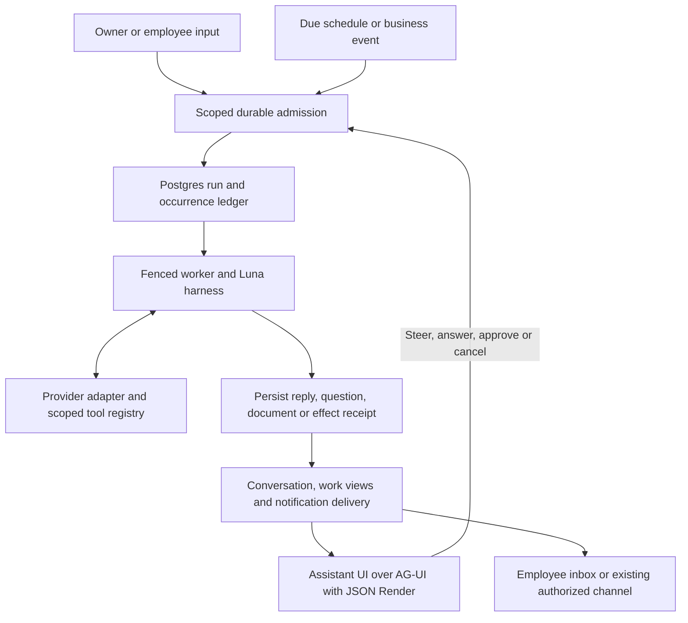

# Luna rebuild implementation handoff

Start here on `luna/complete-rebuild`. The product is a proactive operator for owner-led retail businesses. Owners delegate outcomes through conversation. Luna can independently observe, investigate, schedule, act within an approved mandate, reach staff through their own scoped inbox and bring the owner the results or a decision. Launch as one Luna across surfaces. Preserve business data, conversations, approvals, schedules and saved files. The [reference comparison and acceptance ledger](luna-rebuild.md) cover the seven interaction projects, model SDKs and the migration scope.

This branch is based on main at `28622880e664cba2b9396546e551806eb66f7c80`. PR #593 was still a draft at `2367d6513e9629d5d55a3e2446ab69960b2014c3` when checked. It owns external ingest, archives, grants and research discovery. Luna uses its merged tenant-scoped interfaces, with no new connection or ingestion stack. The rebuild can implement against current canonical business services and an interface for scoped source access now. Once #593 merges, check its effective grant semantics and reconcile any overlaps with its research tools or migrations. [PR #593](https://github.com/killbill2792/aicafe/pull/593)

## What the execution references establish

| Lifecycle | Source and test evidence | Requirement for Luna |
| --- | --- | --- |
| Admit an interactive request | OpenClaw's agent turn service resolves the expected session, reserves request identity, commits input under the current principal, reserves the session lane and publishes acceptance plus replay. Its session controller owns the mailbox across entry points. Hermes uses an origin descriptor, a logical session and an ordered overflow queue. | Acknowledge only stored input and its logical run. Browser, WhatsApp and staff use a common admission contract. Carry actor, tenant, source, request key and conversation. Repeated admission returns the same run. [OpenClaw turn service](https://github.com/openclaw/openclaw/blob/8d356ea5b2bf0273bca359c468a75c20be363888/src/gateway/agent-turn/agent-turn-service.ts) · [OpenClaw session controller](https://github.com/openclaw/openclaw/blob/8d356ea5b2bf0273bca359c468a75c20be363888/docs/concepts/session-controller.md) · [Hermes gateway lifecycle](https://github.com/NousResearch/hermes-agent/blob/1d15aad1dfa8e9e5fcbd2082cad5666a0907a07d/website/docs/developer-guide/gateway-session-lifecycle.md) |
| Reason and use tools | OpenClaw's model attempt emits distinct lifecycle, text and tool events. A native Responses event can finish a provider response while the host turn continues. Hermes builds context, selects its provider wire format and pairs every tool call with a result, including interrupted calls. Its registry supports progressive search and description of tools before invocation. | Keep application state and provider continuation distinct. Reuse native provider tools, current business tools and dynamically discoverable tool descriptions. Decide completion after tool and output persistence. Return validation and capability failures to the model as tool results. [OpenClaw loop](https://github.com/openclaw/openclaw/blob/8d356ea5b2bf0273bca359c468a75c20be363888/docs/concepts/agent-loop.md) · [Hermes loop](https://github.com/NousResearch/hermes-agent/blob/1d15aad1dfa8e9e5fcbd2082cad5666a0907a07d/agent/conversation_loop.py) · [Hermes tool discovery](https://github.com/NousResearch/hermes-agent/blob/1d15aad1dfa8e9e5fcbd2082cad5666a0907a07d/website/docs/user-guide/features/tool-search.md) |
| Steer, stop, wait and recover | OpenClaw feeds accepted steering to the next legal model boundary and keeps its original order if replay is safe. A yielded parent retains a specific wake obligation across successor admission. Hermes tests request-scoped provider interruption, tool-result closure and durable ownership after worker death. | Accept edits as ordered durable inputs. Record an exact run cancellation and fence the old worker. Resume a question or child result through its saved identity. Release the worker while waiting. A new tab or worker must be able to see what was accepted. [OpenClaw steering](https://github.com/openclaw/openclaw/blob/8d356ea5b2bf0273bca359c468a75c20be363888/docs/concepts/queue-steering.md) · [OpenClaw yield and handoff](https://github.com/openclaw/openclaw/blob/8d356ea5b2bf0273bca359c468a75c20be363888/docs/concepts/subagent-yield-handoff.md) · [Hermes interruption tests](https://github.com/NousResearch/hermes-agent/blob/1d15aad1dfa8e9e5fcbd2082cad5666a0907a07d/tests/agent/test_close_interrupted_tool_sequence.py) |
| Timed and event-triggered work | OpenClaw records schedule ownership apart from a finished attempt and routes a signed event into the existing automation path. Hermes records a provisional missed occurrence before dispatch, tracks the scheduled instant, bounds catch-up and coalesces permitted bursts by entity. Its idle heartbeat can wake an existing conversation and yield no notification when nothing changed. | Use the existing minute worker independent of POS refresh. Durable due identity, schedule revision, UTC instant and IANA zone belong to the occurrence. Keep relative request time and worker time distinct. Store trigger observations, source event IDs, quiet windows and reasons for skipped or coalesced work. Keep one-shot reminders pending through recoverable delay. Let Luna evaluate material changes and suppress routine chatter. An unavailable source stays visible to Luna and in work history. [OpenClaw schedules](https://github.com/openclaw/openclaw/blob/8d356ea5b2bf0273bca359c468a75c20be363888/docs/automation/cron-jobs/schedules.md) · [OpenClaw events](https://github.com/openclaw/openclaw/blob/8d356ea5b2bf0273bca359c468a75c20be363888/docs/automation/mcp-events.md) · [Hermes missed occurrences](https://github.com/NousResearch/hermes-agent/blob/1d15aad1dfa8e9e5fcbd2082cad5666a0907a07d/website/docs/developer-guide/cron-internals.md) · [Hermes heartbeat](https://github.com/NousResearch/hermes-agent/blob/1d15aad1dfa8e9e5fcbd2082cad5666a0907a07d/website/docs/user-guide/features/heartbeat.md) |
| Settle outputs and deliver | OpenClaw's terminal receipt distinguishes a saved reply and provider-confirmed delivery. Hermes cron write-back matches the exact execution in both queue and run record, regardless of which settles first. Hermes interactive recovery can visibly redeliver a possibly sent message. Hermes cron fences an ambiguous send as unknown. | Use an immutable delivery key per result and destination. In-product delivery can commit result and receipt atomically. Externally use the connector's idempotency or reconcile via its receipt. Keep uncertainty visible and avoid automatic duplicate reminders or effects where proof is unavailable. [OpenClaw delivery](https://github.com/openclaw/openclaw/blob/8d356ea5b2bf0273bca359c468a75c20be363888/docs/automation/cron-jobs/delivery.md) · [Hermes delivery write-back](https://github.com/NousResearch/hermes-agent/blob/1d15aad1dfa8e9e5fcbd2082cad5666a0907a07d/cron/delivery_outcome.py) · [Hermes interactive delivery ledger](https://github.com/NousResearch/hermes-agent/blob/1d15aad1dfa8e9e5fcbd2082cad5666a0907a07d/gateway/delivery_ledger.py) |
| Learn and correct | OpenClaw records source lineage for promotion, merges and supersession. Hermes separates transcript search, curated memory and procedural skills. Fork tests exercise memory read/write scope, while staged corrections bind to the exact revision. | Keep scoped business facts, editable owner memory and learned instructions distinct. Store provenance and revision. Resolve active memory on each new run and check access on resume. Skills can be discovered by description and loaded on demand. A learned skill or employee observation cannot grant a tool permission or supersede canonical metrics. [OpenClaw memory provenance](https://github.com/openclaw/openclaw/blob/8d356ea5b2bf0273bca359c468a75c20be363888/docs/concepts/memory-provenance.md) · [Hermes memory](https://github.com/NousResearch/hermes-agent/blob/1d15aad1dfa8e9e5fcbd2082cad5666a0907a07d/website/docs/user-guide/features/memory.md) · [Hermes skills](https://github.com/NousResearch/hermes-agent/blob/1d15aad1dfa8e9e5fcbd2082cad5666a0907a07d/website/docs/user-guide/features/skills.md) |

Grok Bot's official overview and design article still returned HTTP 403 after the cloud workspace restarted. xAI's public GitHub organization has Grok Build source, which describes the coding agent and provides no primary source for the requested Grok Bot product. Carry the owner's Grok Bot objectives into the specification and revisit the two official pages when access is applied. Record any decision changed by those pages in this PR before product code proceeds. [Grok Bot overview](https://docs.x.ai/grok-bot/overview) · [Grok Bot design](https://x.ai/news/designing-grok-bot)

## Selected architecture

- **Harness and state.** Reuse the existing Postgres run claims, worker quota accounting, proposals and effect receipts. Build the Luna step orchestration around authenticated input, provider attempts, tool execution, persisted output and delivery. Start at `lib/ai/supervisor/runs/{repository,worker}.server.ts`, the checkpoint SQL under `supabase/migrations/20261119170001_task6_15c_owner_run_checkpoint.sql` and the owner turn baseline in `lib/ai/conversations/agentRunner.server.ts`. Retain only service-level dependencies from the legacy pipeline. Today the legacy owner, commitments, routines and investigations enter distinct execution paths. The first integration must show one newly admitted on-turn request and one off-turn occurrence evaluated by the same replacement harness.
- **Provider and capabilities.** Define a bounded adapter for native stream events, continuation, invocation, usage, typed errors and termination. Start with existing OpenAI Responses transport and approved model configuration. Keep Responses deferred discovery and provider-native tools where appropriate. Vercel AI SDK provider contracts are the interoperability reference for Anthropic and Gemini. OpenAI Agents JS provides comparison points for serialization and resuming a particular tool approval. A provider library can own request or event normalization. Persisted state, usage, permissions and effects remain application contracts. Change the production model only with recorded tool accuracy, cost per completed assignment and time to first useful result on the same authorized corpus.
- **Scheduler.** Target the existing Vercel minute tick in `app/api/cron/supervisor-run-worker/route.ts`. Use its shared queue and tenant fairness when scheduling reminders, investigating a changed observation or running a recurring assignment. Keep `refresh-derived` responsible for preparing relevant data. Share existing commitments, routine definitions and occurrence records while migrating admission. The current business/routine/local-date uniqueness serves one occurrence per day and needs a compatible due-instant identity for higher frequencies and an event identity for event-triggered work. Enforce claim ownership and use measured load and due lag to size batches. Prove delivery when refresh is disabled.
- **Interaction.** Adopt Assistant UI primitives with the official `@assistant-ui/react-ag-ui` runtime and AG-UI events. Use server IDs, persisted snapshots and a reconnect cursor. The worker's verified state owns buttons and status. Disconnecting drops a subscription. Stop calls server cancellation and awaits the result. Preserve original question values including zero and false, exact approval versions, chronological conversation and saved outputs. Use the same APIs for touch and desktop. The new UI is opt-in during migration. CopilotKit's runtime, A2UI, AI Elements and OpenBot supplied alternatives and interoperability evidence, detailed in the [comparison](luna-rebuild.md).
- **Presentation and files.** Use the existing JSON Render catalog and React/PDF packages. Keep the full authored document, plain content and safe presentation data. Render supported nodes and preserve unsupported sections as readable or downloadable data. Send Luna structured diagnostics with the relevant source path and reason so it can repair or choose another representation. Use private attachment storage and stable document/version IDs, immutable revisions and an expected predecessor for edits. Check receipt and authorization before presenting a saved or downloaded document. Prior attachments and reports remain discoverable.
- **Permissions and rollout.** Resolve the acting user and active business from trusted context. Recheck source grants, recipient membership and effect authorization immediately before execution, after resume and on artifact access. Existing proposal and receipt services govern external effects. Pin the engine atomically at admission and keep it immutable across workers. On rollback stop new rebuild admissions, drain or reconcile previously admitted work by its recorded engine and preserve existing IDs. Owner approved local engine pinning, occurrence deduplication and predecessor-versioned documents in this conversation. Production activation, migrations, paid verification and destructive retirement have separate authorization.

## Sequence for the next worker

1. Open the draft from this branch and use the architecture summary in its body. Complete the Grok Bot primary-source review when the network policy allows it. Use this analysis and the upstream comparison rather than repeating the completed source and compatibility passes.
2. Establish the harness vertical slice first. Test durable admission of an unexpected owner question and a due assignment through the same runtime. Use a deterministic provider and a real local database, force a worker crash between state transitions, race two workers and check the precise final receipt. Test ordered steering and revocation before an effect. Define capability-to-evidence IDs in the existing acceptance infrastructure and keep the linked ledger current.
3. Extend timed admissions to events, recurring occurrences and owner outreach. Prove missed timing, timezone gaps and overlaps, event deduplication, starvation resistance under concurrent cafés, quiet valid outcomes, and separate terminal execution and delivery. Integrate the existing staff inbox, notifications, memory/corrections, approvals and scoped business services as tools in this same harness.
4. Attach the new interface and project persisted work state. Verify remote and reconnection behavior on mobile and desktop, then join files, version editing, routines, memory, settings, employee inbox and permissions. Save valid model-authored content and exercise render recovery with unsupported widgets, formatting and non-string question values. Keep the old route behind the approved switch through acceptance.
5. Recheck the merged #593 contract, migrations, two-business isolation and existing business screens. Go through repository CI, current-head review and the required owner-authorized live tests with persisted evidence. Keep this PR in draft through cutover readiness. Record any open scenario as unverified and use the existing review and handoff rules.

## Verification and workspace state

- **OpenClaw upstream:** 28 passing tests across scheduling, schedule identity, timestamp validation and delivery evidence. Run the four source paths `src/cron/{schedule,schedule-identity,validate-timestamp}.test.ts` and `src/agents/delivery-evidence-values.test.ts` at the pinned revision with Vitest 5.0.5 and Croner 10.0.1. The isolated terminal-outcome suite failed to load an additional internal workspace package and remains unverified by execution. Its source and assertions were inspected. The scheduler delivery and session-lane cases above were also inspected.
- **Hermes upstream:** 101 passing tests across the cron delivery write-back, restart-safe worker death evidence, gateway delivery ledger, scoped memory forks, event coalescing, interrupt handling and scheduled occurrence suites. Reproduce from the pinned revision with `python -m pytest -q` on `tests/cron/test_delivery_outcome_writeback.py`, `tests/cron/test_restart_safe_worker_death_evidence.py`, `tests/gateway/test_delivery_ledger.py`, `tests/agent/test_memory_manager_fork_scope.py`, `tests/gateway/test_webhook_coalescing.py`, `tests/agent/test_close_interrupted_tool_sequence.py`, `tests/agent/test_background_review_memory_scope.py`, `tests/agent/test_cascading_interrupt.py`, `tests/cron/test_scheduled_occurrence.py`, `tests/cron/test_misfire_backstop_oneshot_grace.py` and `tests/cron/test_oneshot_grace_due_scan.py`. Tests used an isolated Python 3.12 environment with pytest and upstream runtime dependencies. These results exercise upstream invariants.
- **Interface compatibility:** Released Assistant UI 0.15.38, its AG-UI adapter 0.1.13 and AG-UI 1.0.5 assembled a streamed message plus state and rendered the composer with React 19.2.8. The application integration remains to be built and tested. The application lockfile's existing SheetJS URL was blocked from this environment, so the compatibility probe used a temporary dependency installation without SheetJS.
- **Product state:** This push contains research and implementation guidance. The early local experiment with run pinning, cron routing, clock handling, document versioning and a conversation endpoint was paused when the owner requested the harness-first sequence. It is not part of this PR or acceptance evidence. Two provisional SQL files were applied only to the disposable local database. Recreate it from the selected branch migrations before authoritative testing. No paid provider work, production migration, deployment or live delivery has been executed.
- **Publication blocker:** Git accepts pushes to the selected branch. The GitHub PR API returned HTTP 403 with and without escalated shell permissions. The active network policy had no custom host rules after restart. Use authorized GitHub access to open this branch against main. Review the saved cloud settings for `api.github.com`, `docs.x.ai`, `x.ai` and `cdn.sheetjs.com` or use a signed-in browser for PR creation. The shared desktop control tool was unavailable in this chat. CI and independent review are pending a PR. [Open the existing branch as a draft PR](https://github.com/killbill2792/aicafe/compare/main...luna/complete-rebuild?expand=1)
