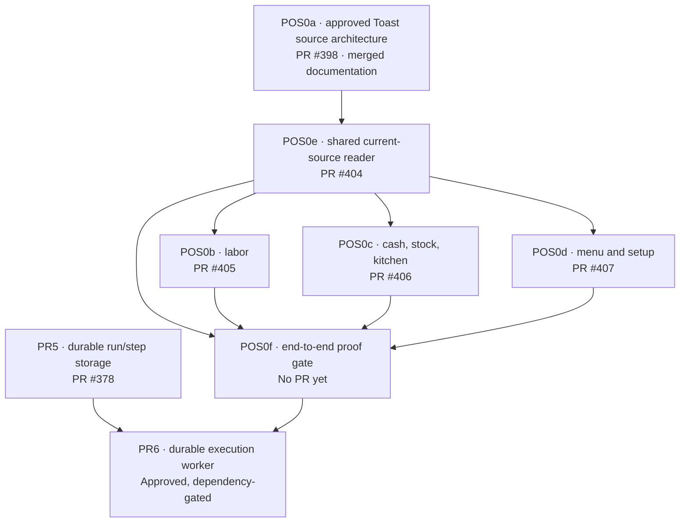

# AI CAFE — Living owner blueprint

> **Start here for a new idea, a fix, or a six-month lookback.** This is the human-readable index of the **existing** AI CAFE architecture and its decision → task → PR → proof chain. It is **not** an authorization source, a second queue, or a claim that untested features work.

**Open the [live owner control center](https://github.com/killbill2792/aicafe/issues/411#issuecomment-6752417190) for the latest PR, CI, Codex, courier and owner-decision status.** Its status is automatically rebuilt by the trusted-main GitHub dispatcher when that workflow runs; reload the issue page to see updates. The 5-minute scheduled check is best-effort, not continuous or guaranteed. Owner can comment `refresh status` on [issue #411](https://github.com/killbill2792/aicafe/issues/411).

## 1. What are we building?

AI CAFE is one universal, proactive café operator called **Supervisor**. It grounds answers in authorized café data, uses shared calculations, obtains the owner's approval for consequential effects, and carries approved work through to verified outcomes. It is not a set of persona agents. See [the binding product and agent rules](../../AGENTS.md), [current progress](../../PROGRESS.md), [current product description](../01-product.md), and [binding data rules](../rules/pos-data.md).

**Development system:** the owner discusses and approves architecture; the canonical [task queue](universal-supervisor-queue.json) and [task briefs](universal-supervisor-task-briefs.md) define exactly which approved task may code which files. The [single trusted GitHub dispatcher](../../scripts/dev-dispatcher/README.md) selects eligible work and evaluates PR/CI/Codex/acceptance/integration gates. Muse (or a specifically assigned courier) transfers the exact prompt into the original ChatGPT/Claude chat and reports an authenticated receipt. Coders own one PR/chat until completion. **No courier, drawing, chat answer, dashboard or document silently grants a coding/production approval.**

## 2. Current approved architecture → PR map

The graph is the **approved dependency contract**, not proof that any implementation is complete. Its labels are intentionally stable; the [live owner control center](https://github.com/killbill2792/aicafe/issues/411#issuecomment-6752417190) generates current status labels from the same GitHub queue and ledger.

| Task | Human meaning | Decision and deliverable | Live implementation link | Final completion rule |
| --- | --- | --- | --- | --- |
| POS0a | Inventory the real Toast field/source contract | Owner accepted [#398 architecture](https://github.com/killbill2792/aicafe/pull/398#issuecomment-6734438172); **read-only documentation**, not runtime proof | [PR #398](https://github.com/killbill2792/aicafe/pull/398) | Verified merged documentation; no invented `integrated_proven` runtime gate |
| POS0e | Build one safe, complete shared reader first | Scoped approval recorded in [queue](universal-supervisor-queue.json); current source vs diagnostic-only isolation | [PR #404](https://github.com/killbill2792/aicafe/pull/404) | Actual executed accepted reader/one-agent parity proof and current-head reviews |
| POS0b | Correct staff and labor fields/freshness | Scoped approval in queue; coordinate exclusive shared files | [PR #405](https://github.com/killbill2792/aicafe/pull/405) | Verified labor SQL, parity and current-head CI/review |
| POS0c | Correct operational cash/stock/kitchen/availability | Scoped approval in queue; explicit approval required for out-of-scope files | [PR #406](https://github.com/killbill2792/aicafe/pull/406) | Executed operational SQL/scenario proof and current-head CI/review |
| POS0d | Correct versioned Toast menu and setup | [D4C menu decisions](https://github.com/killbill2792/aicafe/pull/398); scoped approval in queue | [PR #407](https://github.com/killbill2792/aicafe/pull/407) | Menu identity/retention and authorized proof, current-head CI/review |
| POS0f | Demonstrate the **whole** Toast → storage → Supervisor and screen flow | Approved task in queue; depends on POS0e/b/c/d | [Live dashboard](https://github.com/killbill2792/aicafe/issues/411#issuecomment-6752417190) | Full acceptance and merged-main integration proof; releases later work |
| PR6 | Durable worker/cross-turn execution | Approved task in queue; depends on PR5 and POS0f | [Queue](universal-supervisor-queue.json) | Its own evidence and dependency gates; no premature dispatch |

**Later roadmap:** PR7–PR17 and additional ideas have [proposed briefs](universal-supervisor-delivery-queue-2026-11.md). A proposed milestone is **not** owner-approved coding work. The canonical queue, not this prose, controls eligibility and file ownership. The separate order-import recovery idea also has architectural principles but no approved implementation file scope.

## 3. Why did we choose this architecture?

These are **links to the actual decisions**, not new approval grants. Where an older statement conflicts with a later authenticated decision, follow the later decision and [AGENTS.md](../../AGENTS.md).

| Decision | Owner-accepted principle | Evidence and limits | Implementation owner |
| --- | --- | --- | --- |
| D1–D3: preserve and audit existing data paths | No new competing POS pipeline; preserve storage, readers, historical facts and café isolation until consumers and rollback are proven | [AGENTS.md POS0 gates](../../AGENTS.md); [source authority](../rules/pos-data.md) | POS0e/b/c/d with POS0f final proof |
| D4A: freshness | Change-driven checks using the existing coordinator, not blanket full downloads every ten minutes | [Approved architecture record](https://github.com/killbill2792/aicafe/pull/398#issuecomment-6727889494) and [coverage matrix](toast-standard-api-coverage-matrix.md); not a new scheduler approval | POS0b/c/d |
| D4B: order recovery | Repair the **existing** importer/retry path and retain valid facts; no second ingestion pipeline | [Owner selection](https://github.com/killbill2792/aicafe/pull/398#issuecomment-6727889494); exact recovery SQL/files remain **unapproved** | Separate task not yet authorized |
| D4C: published menus | One authenticated complete/version-consistent published Toast menu; safely inactivate vanished items, keep history, never guess identity or COGS | [D4C decision](https://github.com/killbill2792/aicafe/pull/398#issuecomment-6714937954), [later supersession](https://github.com/killbill2792/aicafe/pull/398#issuecomment-6727941284) | POS0d with POS0f proof |
| POS0a foundation | Owner-merged source coverage document is accepted as documentation prerequisite; **not** a deployed runtime feature | [Explicit signoff](https://github.com/killbill2792/aicafe/pull/398#issuecomment-6734438172) | POS0a complete as document; later tasks own runtime |

## 4. How a NEW idea or fix enters the system

1. **Discuss in one planning chat.** Start from this blueprint and the relevant current architecture. Compare the proposed change with the actual current code and binding rules; draw the affected architecture and alternatives using the already-installed [`diagram-design`](../../.claude/skills/diagram-design/SKILL.md) or GitHub-native Mermaid. Use Superpowers brainstorming. Treat chat discussion as a draft, not an authorization.
2. **Make the decision explicit.** Record what you chose, what you rejected, the reason, affected capabilities, constraints, what can change, what must remain, and the specific acceptance outcome in an authenticated GitHub issue/PR owner record. **The owner's actual GitHub decision is authoritative.** If you only say yes in a chat, the dispatcher must still obtain/reconcile the authentic owner approval; it cannot infer authorization from a courier.
3. **Split into small, collision-free task PRs.** Update the **one existing** canonical queue and task briefs with task IDs, dependencies, stack base, exact exclusive files, acceptance scenarios, and per-task architecture approval. A roadmap/visual does not substitute for those approvals. An independent task uses `main`; a dependent task opens an early draft against its open predecessor branch.
4. **Leave execution to the existing system.** GitHub chooses eligible assignments; Muse/Grok/Telegram courier copies/pastes to the assigned verified existing ChatGPT/Claude chat, never edits code or invents a conversation URL. Busy chats are deferred. The original coder returns its evidence and needed decisions to the **same** PR.
5. **Prove every transition.** Exact-current-head CI, full Codex review, resolved threads, actual acceptance job/artifact, current main/rebased dependencies and strict merge checks must pass. After merge, separate merged-main integration proof is required. A deployed/real-café action has a further explicit owner gate.
6. **Revisit any time.** Open this blueprint for stable intent and decisions; open [issue #411](https://github.com/killbill2792/aicafe/issues/411#issuecomment-6752417190) for current work, pending approvals and the auto-generated dependency map. Read the original linked GitHub decision and exact CI/review receipts when you need the underlying reason. **Never overwrite history to make unfinished work appear done.**

### Reusable human-readable decision card (documentation only)

Use this when preparing an owner decision **in an existing GitHub issue or the task's PR**; it does not create a second approval system:

> **Problem:** What is wrong or missing, in plain words?  
> **Current design:** What is the actual working path today?  
> **Decision / alternatives rejected:** What was chosen, why, and what remains unapproved?  
> **Source and boundaries:** What data enters, key/identity, storage, readers, effects and café isolation?  
> **Task split:** Which PR owns which exact files; which PR is the shared foundation?  
> **Verification:** Which real scenario proves success, where is the executed test/CI/merge/integration link?  
> **Owner authorization:** Link to authenticated GitHub approval and its exact scope.  
> **Change history:** What prior decision does this supersede, and what must be retained?

## 5. What does a status actually mean?

| Word in the dashboard | Correct interpretation |
| --- | --- |
| Proposed | An idea or brief, **not** permission to code |
| Approved / assigned | Exact scoped work permitted; not delivered |
| Muse `planned` | GitHub queued a prompt. It is **not proof of pickup or submission**. A later stale-head cancellation doesn't prove an earlier delivery never happened |
| Muse `submitted` | Valid authenticated courier receipt. It does **not** prove the coding chat finished the task |
| Busy / uncertain | Courier/browser evidence is incomplete; do not repeat blindly or assume failure |
| Draft PR | Work in progress. A green unit job or a clean review of an older head is not completion |
| CI green / Codex clean | Evidence for those **specific checks and exact head**, not full acceptance or integration |
| Acceptance proven | Required scenarios actually executed and immutable proof validated |
| Merged | Code has landed in GitHub; application capability may remain unproven |
| Integrated proven | Dispatcher validated the required executed proof against merged main |
| Released proven | Separately authorized external/product outcome was observed and verified |

**Watch for stale data:** The trusted-main five-minute scheduler is best-effort. The dashboard must show the last completed reconciliation and should not infer browser state from the private ledger. Refreshing the browser only retrieves the latest already-published GitHub comment; it does **not** force a dispatcher run.

## 6. What this blueprint deliberately does NOT do

- It does not store or display private ChatGPT/Claude conversation URLs, raw courier prompts, private receipts, credentials, café data or account secrets.
- It does not merge drafts, approve scopes, change the queue, run a browser, create a new cron, trigger a production migration, or override GitHub's protection and acceptance gates.
- It does not call a static image or an old PR comment a live source of truth.
- It requires **no paid skills, GitHub Copilot, Notion, external database, hosted dashboard or GitHub Pages**. GitHub Markdown/Mermaid, your installed `diagram-design` and the existing dispatcher are sufficient.

## 7. Six-month reading guide

**What did we intend?** Read sections 1–3 and the linked original owner decision. **What changed?** Follow its scoped task(s) and PR conversation disposition. **What was actually verified?** Inspect executed acceptance, exact-head CI/Codex, merge SHA and post-merge integration. **What still needs me?** Open the live [owner dashboard](https://github.com/killbill2792/aicafe/issues/411#issuecomment-6752417190); don't infer a decision from a chat transcript. **What next?** Pick the next owner-approved and dependency-eligible task from the existing queue.

---

*This document is an explanatory view of existing authoritative records. It is updated through reviewed GitHub changes when an architecture decision is added or superseded; its live status companion is rebuilt by the existing dispatcher from GitHub facts. If it conflicts with AGENTS.md, the canonical queue, an authenticated owner decision, or executed proof, those sources win.*
